# SDA-DSC-211
# Tamweel Lite: Loan-Default Review Model

An end-to-end tabular machine-learning project that ranks synthetic loan applications by 90-day default risk, compares single models with ensembles using leakage-safe forward validation, freezes a cost- and capacity-aware review policy, calibrates the final model, explains it, and exports reproducible challenge predictions.

**Project type:** Individual project, built in five gates (Gate 1 to Gate 5)
**Data:** Synthetic (`tamweel-lite-1.0`). For training use only, not for real financing decisions.


**Contents:** [Overview](#project-overview) · [Key results](#key-results) · [Technical pipeline](#technical-pipeline) · [Figures and explanations](#figures-and-explanations) · [Repository structure](#repository-structure) · [Quick start](#quick-start) · [Limitations](#interpretation-and-limitations) · [Daily answers](#daily-answers--الإجابات-اليومية)

**Full project notebook:** [`Tamweel_Lite_Final_Project.ipynb`](Tamweel_Lite_Final_Project.ipynb) compiles this README and the executed notebooks for every gate into one file.

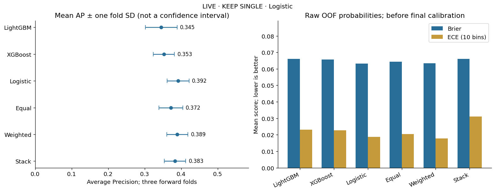

## Project overview

Tamweel Lite predicts `default_within_90d`, a simulated default event within 90 days of an application, from 22 features available at application time. Identifiers, dates and the target are never model inputs, and the leaky field `days_past_due_60` is removed.

The five gates build the complete workflow: baseline boosting models, honest time- and customer-aware validation, a cost-sensitive threshold under a 12% review capacity, interpretation and calibration, and a final single-model-versus-ensemble decision with an exported model and challenge predictions.

Models compared: LightGBM, XGBoost and Logistic Regression, plus three ensembles (equal average, weighted average and logistic stacking).

## Key results

### Final decision: KEEP SINGLE (Logistic Regression)

Nested forward out-of-fold (OOF) results on three comparison periods (2023Q1, 2023Q3 and 2024Q1):

| Candidate | Mean AP | Fold SD | Brier | ECE | Passes gate |
|---|---:|---:|---:|---:|:---:|
| LightGBM | 0.3455 | 0.0435 | 0.0661 | 0.0231 | No |
| XGBoost | 0.3526 | 0.0290 | 0.0657 | 0.0228 | No |
| **Logistic** | **0.3917** | 0.0298 | 0.0633 | 0.0188 | **Chosen (best single)** |
| Equal average | 0.3717 | 0.0326 | 0.0643 | 0.0204 | No |
| Weighted average | 0.3894 | 0.0291 | 0.0633 | 0.0177 | No |
| Stacking | 0.3831 | 0.0295 | 0.0660 | 0.0311 | No |

The worth-it gate accepts an ensemble only if its AP gain exceeds the best single model's fold standard deviation (0.0298), Brier worsens by no more than 0.005 and ECE by no more than 0.01. No ensemble passed, so the simpler model was kept. The fold SD describes three overlapping periods and is not a confidence interval.

### Frozen review policy

| Item | Result |
|---|---:|
| Loss function | 10 x false negatives + 1 x false positives (educational units) |
| Capacity ceiling | 12% in every period and overall |
| Raw OOF threshold | 0.1689 |
| OOF flags | 245 of 2,155 (11.4%) |
| OOF recall / precision | 46.9% / 34.3% |
| OOF loss | 1,111 units |

### Challenge predictions

| Item | Result |
|---|---:|
| Requests scored | 2,500 |
| Above the transported threshold | 330 |
| Final review flags after the 12% cap | 300 |
| Removed by the cap | 30 |

`decision = 1` is a simulated review flag. `decision = 0` is not a safety guarantee or an approval. Challenge labels are unavailable, so no challenge AP, loss or false-positive rate is claimed.

### Results by gate

| Gate | Focus | Main result |
|---|---|---|
| 1 | Baseline boosting | XGBoost had the highest AP of the three baselines (0.3338; Logistic 0.3258, LightGBM 0.3248) |
| 2 | Honest validation | A leaky control scored AP 0.999. Clean time- and customer-aware validation scored about 0.31 |
| 3 | Cost-sensitive threshold | Threshold 0.658 stayed within the 12% cap (10.4% flagged); 0.5 flagged 19.9% |
| 4 | Explain and calibrate | `bureau_score` was the most important feature (permutation AP drop 0.127). Calibration cut Brier from 0.113 to 0.067 |
| 5 | Final model | Single Logistic Regression kept; calibrated model and 2,500 predictions exported |

The Gate 4 explanations belong to the Gate 4 LightGBM model. They are not automatically attributed to the final Logistic model. Every figure from every gate, with an explanation, is in [Figures and explanations](#figures-and-explanations).

## Technical pipeline

1. Validate the data against the contract (22 features, no leakage fields).
2. Reserve July to September 2024 for calibration only and remove those customers from the fitting pool.
3. Build nested forward OOF predictions: training is earlier than validation with a 90-day label-maturity gap, and validation customers are excluded from training.
4. Compare three single models with equal averaging, weighted averaging and stacking. Weights and the stacker learn from inner OOF only.
5. Apply the worth-it gate and keep the simplest passing option, otherwise the best single model.
6. Search every distinct OOF score for the minimum 10 x FN + FP loss under the 12% capacity ceiling.
7. Refit the chosen procedure, learn one sigmoid mapping on the calibration period, and transport the threshold.
8. Score the 2,500 challenge requests, then apply the capacity cap once to the full batch.
9. Export the model in JSON/native format (no pickle), a model card, and a hash-verified project bundle.

See the [Technical Report](docs/TECHNICAL_REPORT.md) and the [Requirements Checklist](docs/REQUIREMENTS_CHECKLIST.md) for the detailed evidence map.

## Figures and explanations

All 19 figures produced across the five gates, in order. Each one is followed by what it shows and what to take from it. All data are synthetic.

### Gate 1: Baseline boosting

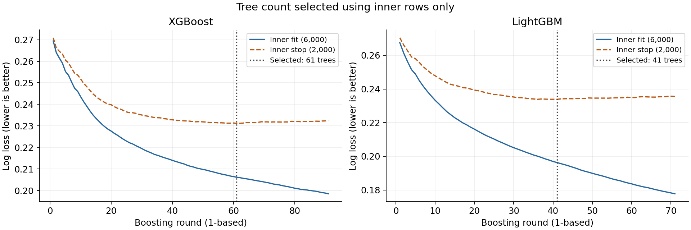

**Learning curves (XGBoost and LightGBM).** Each panel plots log loss (lower is better) against the number of boosting rounds. The solid line is the fit on 6,000 inner rows and the dashed line is a separate 2,000-row stopping set. The fit line keeps falling, but the stopping line flattens, which means extra trees start memorising instead of learning. The dotted vertical line marks the tree count chosen from the stopping set only: 61 trees for XGBoost and 41 for LightGBM. Choosing the tree count on rows the model was not fitted on keeps the later comparison honest.

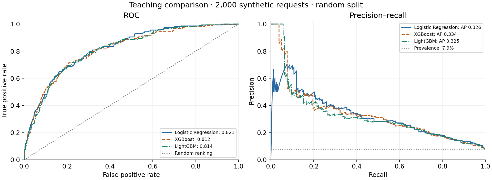

**ROC and precision-recall curves (three baselines).** On a random split of 2,000 synthetic requests, the three models are almost indistinguishable on ROC (AUC: Logistic 0.821, XGBoost 0.812, LightGBM 0.814). Because defaults are rare (7.9% prevalence, the dotted line on the right), average precision is the more informative metric: XGBoost 0.334, Logistic 0.326, LightGBM 0.325. XGBoost was picked first because it had the highest AP, but the gaps are small. This is a teaching comparison on a random split, not an honest time-based test.

### Gate 2: Honest validation

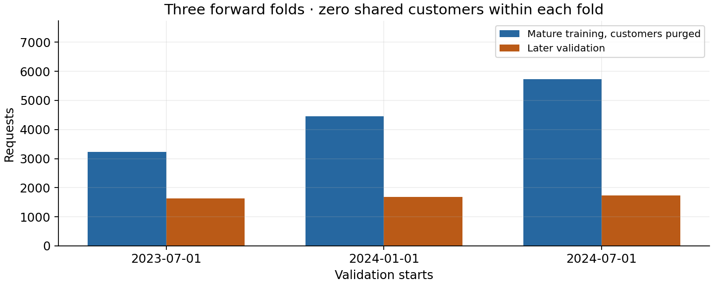

**Forward fold sizes.** Three folds validate on later periods (starting 2023-07-01, 2024-01-01 and 2024-07-01). Blue bars are the training rows, which only include applications whose 90-day outcome had already matured and from which validation customers were purged (about 3,200, 4,450 and 5,700 rows). Orange bars are the later validation rows (about 1,600 to 1,700 each). No customer appears on both sides of any fold. Training data grows over time, as it would in real use.

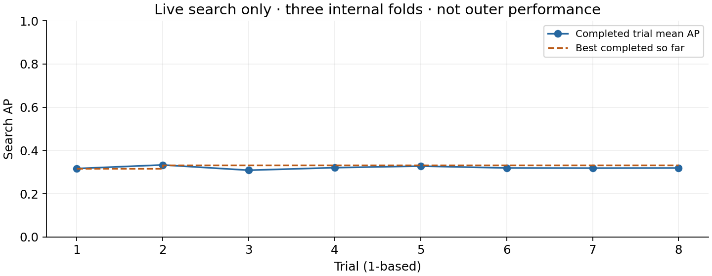

**Hyperparameter search.** Eight Optuna trials, each scored by mean average precision on three internal folds. The score barely moves (about 0.31 to 0.33), and the best trial (trial 2, about 0.333) stays the best. Tuning found almost nothing, so the search space was flat for this data. These are internal search scores, not outer performance.

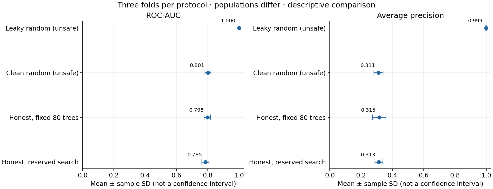

**Leaky versus honest validation.** Four protocols, with mean and sample standard deviation over three folds. The leaky random protocol, which sees post-application information, scores ROC-AUC 1.000 and AP 0.999, which is far too good to be real. Once the future fields are removed and time and customers are respected, AP falls to about 0.31 (clean random 0.311, honest fixed 0.315, honest tuned 0.313). The gap is what leakage looks like. The error bars are not confidence intervals, and the populations differ between protocols.

### Gate 3: Cost-sensitive decision

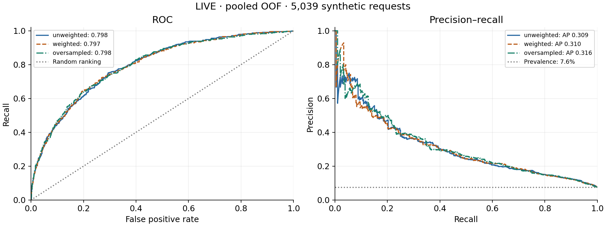

**Imbalance strategies (pooled OOF).** Unweighted, class-weighted and oversampled models on 5,039 out-of-fold requests. ROC-AUC is 0.798, 0.797 and 0.798, and AP is 0.309, 0.310 and 0.316 against a 7.6% base rate. Handling imbalance this way barely changes how well requests are ranked. The real lever is where the decision threshold is placed.

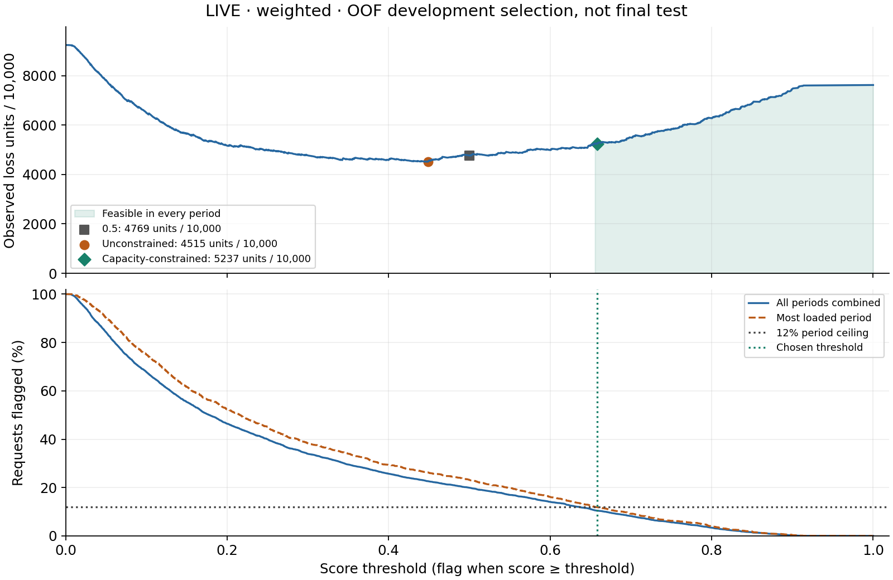

**Cost curve and review capacity.** The top panel shows observed loss per 10,000 requests (10 x missed defaults + 1 x false alarms) for every threshold. The lowest loss with no limit is 4,515 units (threshold about 0.449). The default 0.5 costs 4,769. The shaded region is where every period stays within the 12% review capacity, and the best threshold there is 0.658 at 5,237 units. The bottom panel shows why: the percentage flagged only falls below the 12% ceiling (dotted line) at about that threshold. The extra loss is the price of respecting capacity.

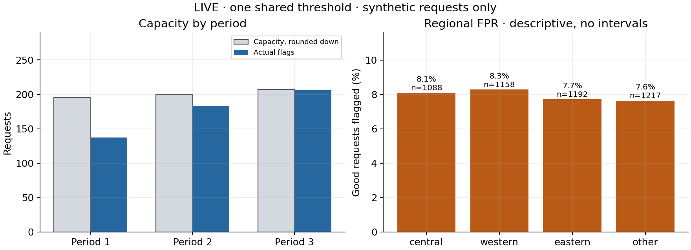

**Capacity by period and regional diagnostic.** On the left, actual flags (blue) against the rounded-down capacity (grey) for each validation period: about 137 of 195, 183 of 200 and 206 of 207, so every period is within its limit. On the right, the false-positive rate for each region is similar (central 8.1%, western 8.3%, eastern 7.7%, other 7.6%), with the number of non-default requests labelled. The roughly 0.65-point gap is descriptive. It has no confidence interval and is not a fairness certification.

### Gate 4: Explain and calibrate

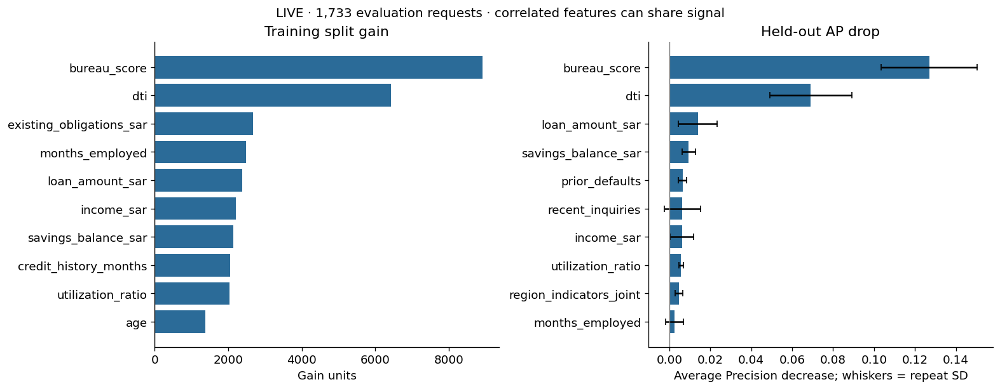

**Feature importance.** The left panel is how much each feature was used for splitting during training (gain). The right panel is how much average precision drops on 1,733 held-out requests when a feature is shuffled, with whiskers showing the spread over repeats. Both views put `bureau_score` first and `dti` second. Shuffling `bureau_score` costs about 0.127 AP and `dti` about 0.069, while the rest cost under 0.02. Some whiskers cross zero, and correlated features can share signal, so small differences are not meaningful. Importance describes the model and does not prove causality.

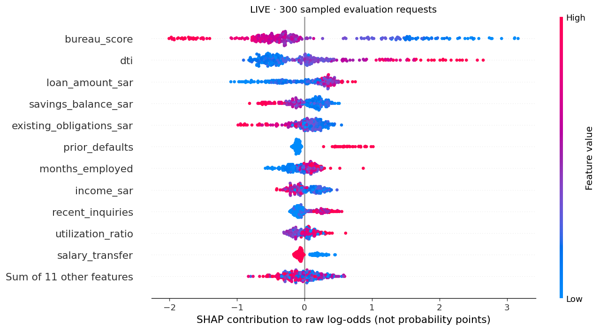

**SHAP summary (beeswarm).** Each dot is one of 300 sampled requests, placed by how much that feature pushed the model's raw score (log-odds, not probability points) and coloured by the feature's value. For `bureau_score`, low values (blue) push risk up, by as much as about +3, and high values (red) push it down. For `dti`, high values (red) raise risk. A non-zero `prior_defaults` (red) raises risk, and more savings lower it. This shows how the model uses the data, not what would happen if a person's feature changed.

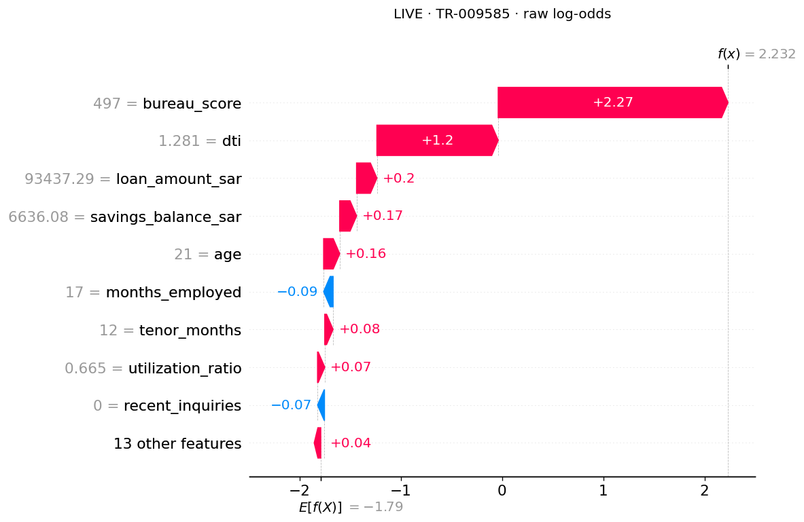

**SHAP waterfall for one request.** A local explanation for request TR-009585, the highest-scoring request in the SHAP sample (chosen without looking at its outcome). The score starts at the model's average, -1.79 log-odds, and each bar adds or subtracts. `bureau_score` = 497 adds +2.27 and `dti` = 1.28 adds +1.2, reaching 2.23. That is a raw probability of 0.903, which calibration reduces to 0.480. It explains this one request only. The global picture is in the beeswarm.

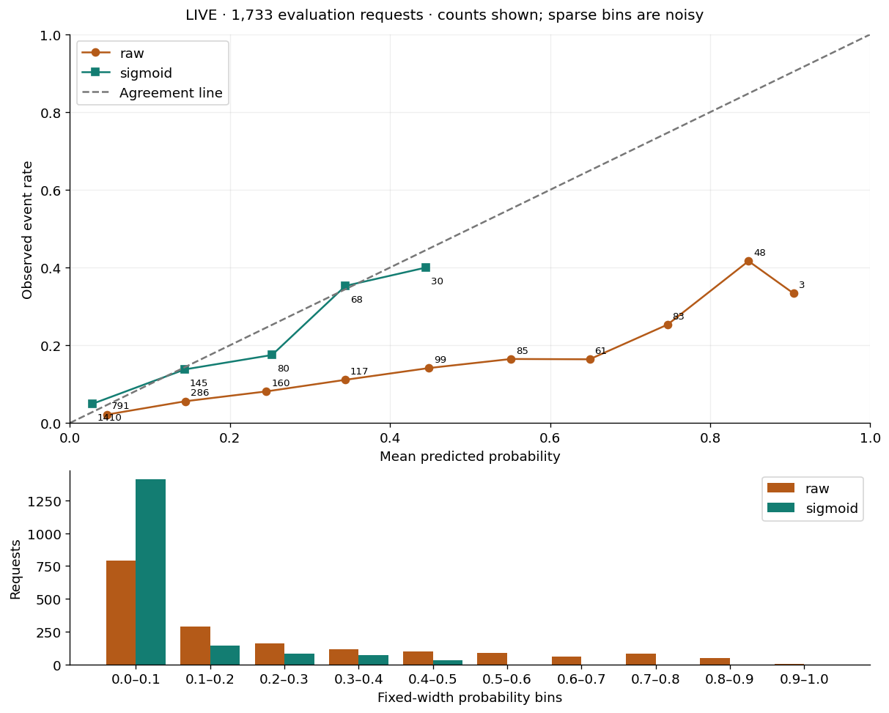

**Calibration (reliability diagram).** The top panel compares predicted probability with the observed default rate on 1,733 evaluation requests. The raw scores (orange) sit well below the diagonal, so the model overstates risk (for example, requests scored around 0.55 defaulted about 16% of the time). The sigmoid mapping (teal) moves the curve close to the diagonal. The bottom panel shows how many requests fall in each bin, and the sigmoid pushes most of them into the lowest bin. Sparse bins (a few dozen requests) are noisy. Brier improved from 0.113 to 0.067 and ECE from 0.147 to 0.022, while ranking quality (AP, AUC) stayed identical.

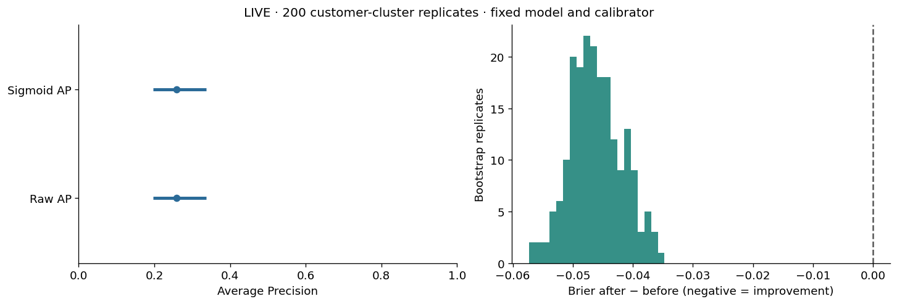

**Stability of the result.** 200 bootstrap replicates, resampling whole customers, with the model and calibrator held fixed. On the left, average precision is the same before and after calibration (about 0.26, with a wide interval of roughly 0.20 to 0.34) because calibration does not change the ranking. On the right, the change in Brier score is negative in every replicate (about -0.058 to -0.035) and never reaches zero, so the improvement is consistent. This does not include the uncertainty from training the model, fitting the calibrator, or future drift.

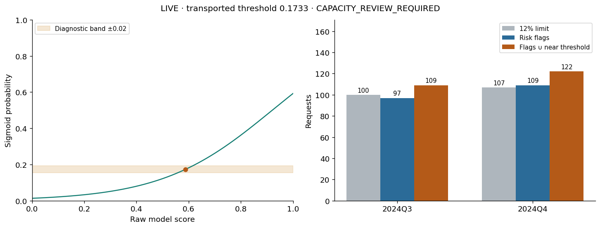

**Review zone and capacity check.** The left panel shows how the raw score maps to a calibrated probability. The chosen raw threshold of 0.588 corresponds to 0.173 after calibration, with a diagnostic band of plus or minus 0.02 around it. The right panel compares the 12% limit with the flags on the two evaluation quarters. In 2024Q3 the limit is 100, risk flags are 97, and flags plus near-threshold requests are 109. In 2024Q4 the limit is 107 and risk flags are 109 (122 with the near-threshold group). The status is `CAPACITY_REVIEW_REQUIRED`, and the threshold was not retuned on evaluation data.

### Gate 5: Final model

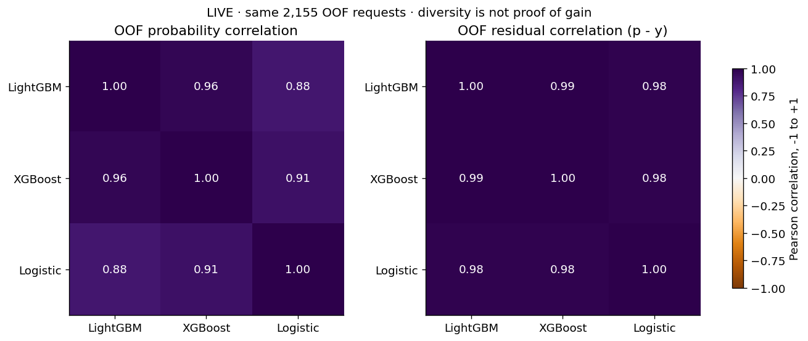

**Model diversity.** The left heatmap shows how correlated the three models' predicted probabilities are on the same 2,155 OOF requests (0.88 to 0.96). The right heatmap shows the residuals (prediction minus outcome), which are even more correlated (0.98 to 0.99). The models make largely the same mistakes, so combining them has little room to help. Low correlation alone would not prove a gain either, so the next figure measures it directly.


**Single models versus ensembles.** The left panel gives mean AP over the three forward folds with one fold standard deviation (not a confidence interval): Logistic 0.392, weighted average 0.389, stacking 0.383, equal average 0.372, XGBoost 0.353, LightGBM 0.345. The right panel shows raw Brier and ECE, where Logistic is among the best on both and stacking has the worst ECE (0.031). No ensemble beat the best single model by more than its fold standard deviation (0.030), so the decision is KEEP SINGLE with Logistic Regression.

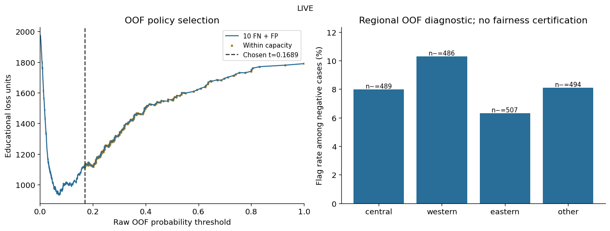

**Final policy and regions.** The left panel is the educational loss (10 x FN + FP) for every raw OOF threshold of the chosen model. The loss is lowest near 0.07, but those thresholds would flag far more than 12% of requests. The dashed line at 0.1689 marks the lowest-loss threshold that stays within capacity (1,111 units). The right panel shows the flag rate among non-default requests by region: central 8.0%, western 10.3%, eastern 6.3%, other 8.1%. The gap of about 3.98 points is descriptive and needs monitoring. It is not a fairness certification.

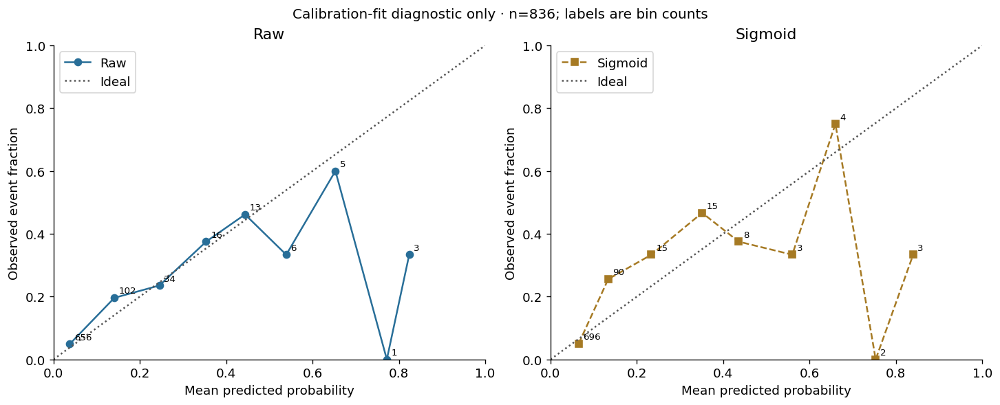

**Calibration fit diagnostic.** The reserved July to September 2024 period (836 rows, 78 defaults) is shown before and after the sigmoid mapping, with the number of requests in each bin. Both curves follow the diagonal at low probabilities, where most requests are, and become erratic above about 0.5 because those bins hold only a handful of requests. On these rows Brier moved from 0.0765 to 0.0781 and ECE from 0.0211 to 0.0349, so the sigmoid did not help here. This is a fit diagnostic on the same rows used to learn the mapping, not an independent test.

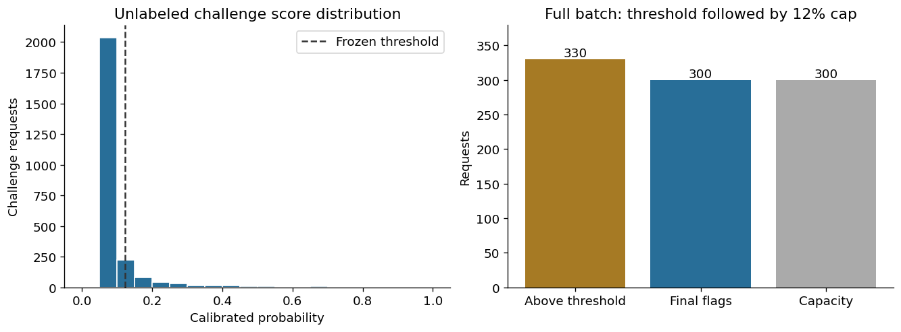

**Challenge predictions and capacity.** On the left, the calibrated probabilities of the 2,500 unlabeled challenge requests. Most are below 0.1, and the dashed line is the frozen threshold (0.1223). On the right, 330 requests exceed the threshold, but the 12% capacity is 300, so the highest-probability 300 are flagged and 30 are removed. The cap was applied once to the whole batch. No challenge performance is claimed because the labels are not available.

## Repository structure

```text
Tamweel-Lite/
├── README.md
├── Tamweel_Lite_Final_Project.ipynb   # README + all gate notebooks in one file
├── PROJECT_README.md
├── requirements.txt
├── requirements-colab.txt
├── requirements-check.txt
├── constraints.txt
├── .github/workflows/
│   └── final_project.yml     # Final Project Check (manual run)
├── notebooks/
│   ├── 00_readiness_check.ipynb
│   ├── 01_baseline_boosting.ipynb
│   ├── 02_validation_tuning.ipynb
│   ├── 03_cost_sensitive_decision.ipynb
│   ├── 04_explain_calibrate.ipynb
│   ├── 05_final_model.ipynb
│   └── 99_final_submission_check.ipynb
├── config/
│   ├── environment.json
│   ├── final_policy.json
│   └── requirements.txt
├── data/
│   ├── data_contract.json
│   ├── data_manifest.json
│   ├── tamweel_train.csv
│   └── tamweel_challenge.csv
├── scripts/                  # course support code, inference, replay, rebuild and final check
├── tamweel/                  # command-line inference wrapper
├── artifacts/                # final tables, figures, policy, metrics, provenance
│   └── final_model/          # exported model and manifest
├── evidence/                 # outputs from the earlier gates, one folder per gate
├── docs/
│   ├── TECHNICAL_REPORT.md
│   └── REQUIREMENTS_CHECKLIST.md
├── reports/
│   ├── MODEL_CARD.md
│   ├── ENSEMBLE_DECISION.md
│   ├── results_summary.json
│   └── gate*_*.png           # all 19 figures shown in this README
├── submission/
│   ├── submission.csv        # application_id, probability, decision
│   └── submission_manifest.json
└── presentation/             # course templates
```

## Quick start

### 1. Clone and install

```bash
git clone https://github.com/Jumanah-A/SDA-DSC-211.git
cd SDA-DSC-211
python -m venv .venv
```

Activate the environment, then install the dependencies:

```bash
pip install -r requirements.txt
```

### 2. Reproduce the saved predictions (no refitting)

```bash
python scripts/replay_final.py
```

This reloads the exported model and checks that every probability and decision matches `submission/submission.csv`.

### 3. Rebuild from data

```bash
python scripts/rebuild_final.py
```

This retrains, reselects and recalibrates from the data and compares the result with the saved submission.

### 4. Predict on new feature rows

```bash
python tamweel/inference.py --input data/tamweel_challenge.csv --output predictions.csv
```

The command returns application IDs and calibrated probabilities only. Apply the frozen threshold and the 12% capacity cap to the complete batch afterwards, as described in `artifacts/final_policy.json`.

### 5. Read the executed notebooks

Open the files in `notebooks/`, for example in Google Colab. They contain the saved outputs of the completed runs.

## Dataset and model

- Dataset: synthetic `tamweel-lite-1.0` (10,000 labeled training rows and 2,500 unlabeled challenge requests)
- Fit and selection pool: 6,576 rows, 3,931 customers, 537 positives (2022-01-01 to 2024-04-01)
- Calibration period: 836 rows, 78 positives (2024-07-01 to 2024-09-30)
- Final model: Logistic Regression with a sigmoid calibration mapping
- Seed: 211. Packages are pinned in `requirements.txt`.

## Interpretation and limitations

- The data are synthetic and do not represent real people or regions. The model is for training use only.
- A review flag is a simulated signal. A zero is not a safety guarantee or a financing approval.
- OOF results are used for development and selection. They are not an untouched final test, and three overlapping forward periods are not a significance test.
- The calibration figures are diagnostics on the rows used to fit the calibrator, not independent performance.
- Transporting a threshold from OOF models to a refitted model can change flag volume, which is why capacity is applied once to the whole batch.
- Loss units are fictional teaching units, not riyals, and review cost is not included.
- No challenge labels are available, so no challenge performance is claimed.
- The regional diagnostic is descriptive and is not a fairness certification.
- See `reports/MODEL_CARD.md` for the full model card, including the monitoring plan.

## Training-program attribution
This project was completed for SDAIA Academy's Advanced Machine Learning program (SDA-DSC-211) with Mrs. Meaad Al-Marri. SDAIA Academy

## Daily answers | الإجابات اليومية

### Day 1 | اليوم الأول


Daily question · Model comparison

**Which model did you select initially, and what is the strongest result supporting your choice?**

Initially I chose the XGBoost model, based on the table above. The XGBoost model has the highest Average Precision of all 3 models of (0.3338). Since default events don't occur often, I chose the average precision as my metric of choice to compare how the well models perform and then select the best one that would identify defaults.


### Day 2 | اليوم الثاني


Daily question · Honest validation


**What leakage risk did you identify, and how did the validation design prevent it?**

I identified a target leakage risk "days_past_due_60", this field is only available after the application (as it happens in the future) and the model shouldn't be able to access it while training. The validation design to prevent it was to remove the "days_past_due_60" field before training the model.


### Day 3 | اليوم الثالث


Daily question · Decision threshold

**Why is a fixed threshold of 0.5 not always suitable for this review policy?**

I didn’t use 0.5 because it would flag 19.9% of requests, but the review team can handle only 12%. I chose a threshold that keeps the number of flags within capacity while balancing missed defaults and false alarms.

### Day 4 | اليوم الرابع


Daily question · Interpretation and calibration

**Which feature was most important in your explanation, and why does that not prove causality?**

bureau_score was the most important feature because the model relied on it most when making predictions. That doesn’t prove it causes defaults. SHAP shows how the model used the data; it doesn’t tell us what would happen if someone’s score changed.

### Day 5 | اليوم الخامس


Daily question · Final model

**Why did you choose the single model or the ensemble for the final project?**

I chose Logistic Regression because it had the best mean AP across the three forward folds: 0.392. The weighted average scored 0.389, stacking 0.383, and equal averaging 0.372. None of the ensembles passed the worth-it check, so the extra complexity wasn’t worth it.
